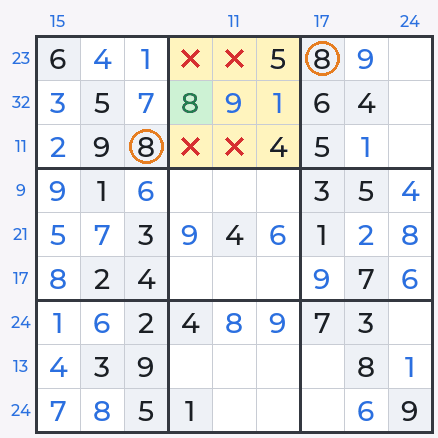

<!-- Written by tools/walkthrough.py sum-skyscrapers: edit the script, not this page. -->
# Sum Skyscrapers, step 31: the 8 in box 2

**Step 31 of 52** · [← Step 30](step-30.md) · [All steps](../sum-skyscrapers.md#the-whole-puzzle-step-by-step) · [Step 32 →](step-32.md)

Box 2 needs an 8. r1c4 and r1c5: row 1 has one (r1c7). r3c4 and r3c5: row 3 has one (r3c3). Only **r2c4** is left: **r2c4 = 8**.

**Step 31 of 52** · [← Step 30](step-30.md) · [All steps](../sum-skyscrapers.md#the-whole-puzzle-step-by-step) · [Step 32 →](step-32.md)
