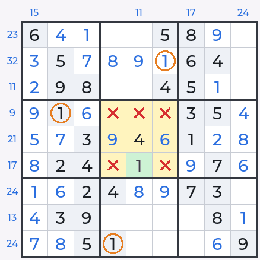

<!-- Written by tools/walkthrough.py sum-skyscrapers: edit the script, not this page. -->
# Sum Skyscrapers, step 32: the 1 in box 5

**Step 32 of 52** · [← Step 31](step-31.md) · [All steps](../sum-skyscrapers.md#the-whole-puzzle-step-by-step) · [Step 33 →](step-33.md)

Box 5 needs a 1. r4c4, r4c5 and r4c6: row 4 has one (r4c2). r6c4: column 4 has one (r9c4). r6c6: column 6 has one (r2c6). Only **r6c5** is left: **r6c5 = 1**.

**Step 32 of 52** · [← Step 31](step-31.md) · [All steps](../sum-skyscrapers.md#the-whole-puzzle-step-by-step) · [Step 33 →](step-33.md)
