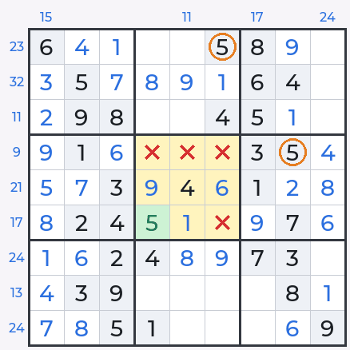

<!-- Written by tools/walkthrough.py sum-skyscrapers: edit the script, not this page. -->
# Sum Skyscrapers, step 33: the 5 in box 5

**Step 33 of 52** · [← Step 32](step-32.md) · [All steps](../sum-skyscrapers.md#the-whole-puzzle-step-by-step) · [Step 34 →](step-34.md)

Box 5 needs a 5. r4c4, r4c5 and r4c6: row 4 has one (r4c8). r6c6: column 6 has one (r1c6). Only **r6c4** is left: **r6c4 = 5**.

**Step 33 of 52** · [← Step 32](step-32.md) · [All steps](../sum-skyscrapers.md#the-whole-puzzle-step-by-step) · [Step 34 →](step-34.md)
