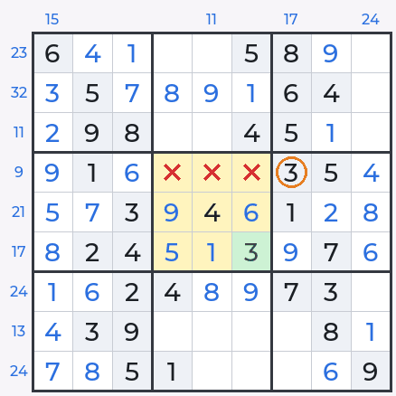

<!-- Written by tools/walkthrough.py sum-skyscrapers: edit the script, not this page. -->
# Sum Skyscrapers, step 34: the 3 in box 5

**Step 34 of 52** · [← Step 33](step-33.md) · [All steps](../sum-skyscrapers.md#the-whole-puzzle-step-by-step) · [Step 35 →](step-35.md)

Box 5 needs a 3. r4c4, r4c5 and r4c6: row 4 has one (r4c7). Only **r6c6** is left: **r6c6 = 3**.

**Step 34 of 52** · [← Step 33](step-33.md) · [All steps](../sum-skyscrapers.md#the-whole-puzzle-step-by-step) · [Step 35 →](step-35.md)
