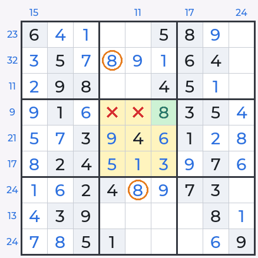

<!-- Written by tools/walkthrough.py sum-skyscrapers: edit the script, not this page. -->
# Sum Skyscrapers, step 35: the 8 in box 5

**Step 35 of 52** · [← Step 34](step-34.md) · [All steps](../sum-skyscrapers.md#the-whole-puzzle-step-by-step) · [Step 36 →](step-36.md)

Box 5 needs an 8. r4c4: column 4 has one (r2c4). r4c5: column 5 has one (r7c5). Only **r4c6** is left: **r4c6 = 8**.

**Step 35 of 52** · [← Step 34](step-34.md) · [All steps](../sum-skyscrapers.md#the-whole-puzzle-step-by-step) · [Step 36 →](step-36.md)
