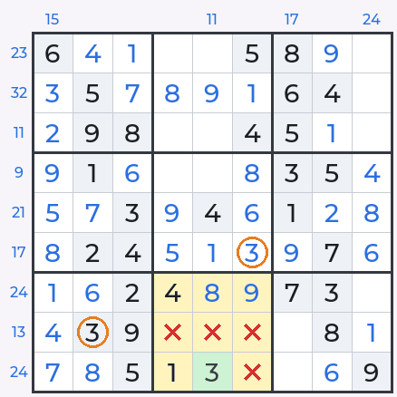

<!-- Written by tools/walkthrough.py sum-skyscrapers: edit the script, not this page. -->
# Sum Skyscrapers, step 36: the 3 in box 8

**Step 36 of 52** · [← Step 35](step-35.md) · [All steps](../sum-skyscrapers.md#the-whole-puzzle-step-by-step) · [Step 37 →](step-37.md)

Box 8 needs a 3. r8c4, r8c5 and r8c6: row 8 has one (r8c2). r9c6: column 6 has one (r6c6). Only **r9c5** is left: **r9c5 = 3**.

**Step 36 of 52** · [← Step 35](step-35.md) · [All steps](../sum-skyscrapers.md#the-whole-puzzle-step-by-step) · [Step 37 →](step-37.md)
