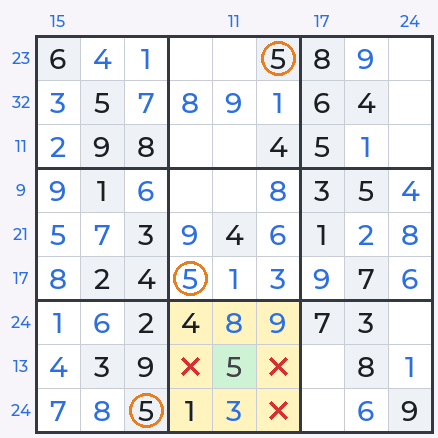

<!-- Written by tools/walkthrough.py sum-skyscrapers: edit the script, not this page. -->
# Sum Skyscrapers, step 37: the 5 in box 8

**Step 37 of 52** · [← Step 36](step-36.md) · [All steps](../sum-skyscrapers.md#the-whole-puzzle-step-by-step) · [Step 38 →](step-38.md)

Box 8 needs a 5. r8c4: column 4 has one (r6c4). r8c6: column 6 has one (r1c6). r9c6: row 9 has one (r9c3). Only **r8c5** is left: **r8c5 = 5**.

**Step 37 of 52** · [← Step 36](step-36.md) · [All steps](../sum-skyscrapers.md#the-whole-puzzle-step-by-step) · [Step 38 →](step-38.md)
