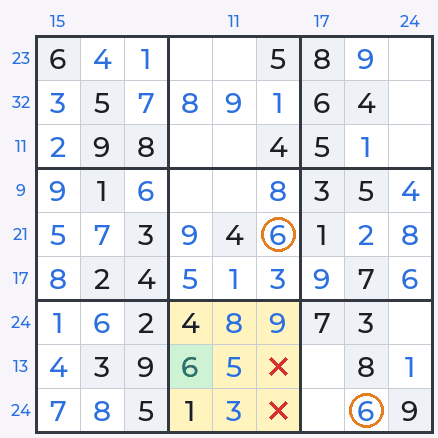

<!-- Written by tools/walkthrough.py sum-skyscrapers: edit the script, not this page. -->
# Sum Skyscrapers, step 38: the 6 in box 8

**Step 38 of 52** · [← Step 37](step-37.md) · [All steps](../sum-skyscrapers.md#the-whole-puzzle-step-by-step) · [Step 39 →](step-39.md)

Box 8 needs a 6. r8c6: column 6 has one (r5c6). r9c6: row 9 has one (r9c8). Only **r8c4** is left: **r8c4 = 6**.

**Step 38 of 52** · [← Step 37](step-37.md) · [All steps](../sum-skyscrapers.md#the-whole-puzzle-step-by-step) · [Step 39 →](step-39.md)
