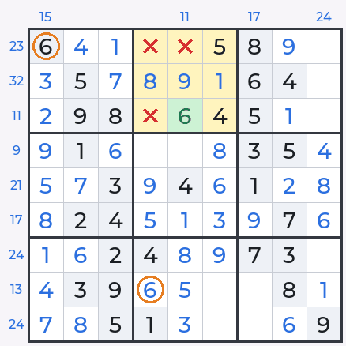

<!-- Written by tools/walkthrough.py sum-skyscrapers: edit the script, not this page. -->
# Sum Skyscrapers, step 39: the 6 in box 2

**Step 39 of 52** · [← Step 38](step-38.md) · [All steps](../sum-skyscrapers.md#the-whole-puzzle-step-by-step) · [Step 40 →](step-40.md)

Box 2 needs a 6. r1c4 and r1c5: row 1 has one (r1c1). r3c4: column 4 has one (r8c4). Only **r3c5** is left: **r3c5 = 6**.

**Step 39 of 52** · [← Step 38](step-38.md) · [All steps](../sum-skyscrapers.md#the-whole-puzzle-step-by-step) · [Step 40 →](step-40.md)
