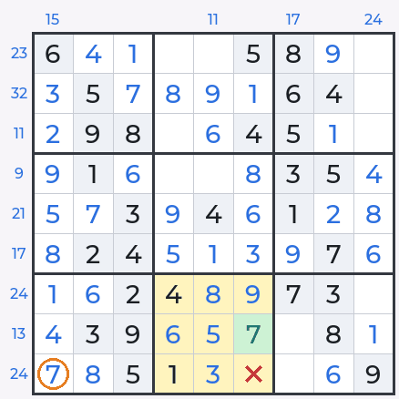

<!-- Written by tools/walkthrough.py sum-skyscrapers: edit the script, not this page. -->
# Sum Skyscrapers, step 40: the 7 in box 8

**Step 40 of 52** · [← Step 39](step-39.md) · [All steps](../sum-skyscrapers.md#the-whole-puzzle-step-by-step) · [Step 41 →](step-41.md)

Box 8 needs a 7. r9c6: row 9 has one (r9c1). Only **r8c6** is left: **r8c6 = 7**.

**Step 40 of 52** · [← Step 39](step-39.md) · [All steps](../sum-skyscrapers.md#the-whole-puzzle-step-by-step) · [Step 41 →](step-41.md)
