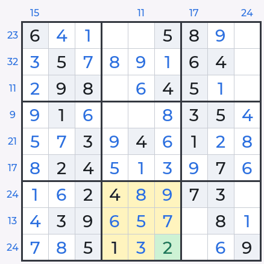

<!-- Written by tools/walkthrough.py sum-skyscrapers: edit the script, not this page. -->
# Sum Skyscrapers, step 41: the 2 in box 8

**Step 41 of 52** · [← Step 40](step-40.md) · [All steps](../sum-skyscrapers.md#the-whole-puzzle-step-by-step) · [Step 42 →](step-42.md)

Box 8 needs a 2, and r9c6 is its last empty cell: **r9c6 = 2**.

**Step 41 of 52** · [← Step 40](step-40.md) · [All steps](../sum-skyscrapers.md#the-whole-puzzle-step-by-step) · [Step 42 →](step-42.md)
