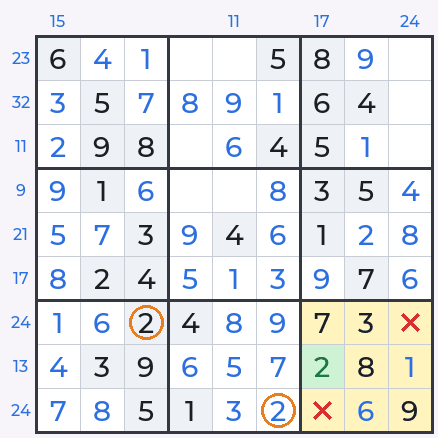

<!-- Written by tools/walkthrough.py sum-skyscrapers: edit the script, not this page. -->
# Sum Skyscrapers, step 42: the 2 in box 9

**Step 42 of 52** · [← Step 41](step-41.md) · [All steps](../sum-skyscrapers.md#the-whole-puzzle-step-by-step) · [Step 43 →](step-43.md)

Box 9 needs a 2. r7c9: row 7 has one (r7c3). r9c7: row 9 has one (r9c6). Only **r8c7** is left: **r8c7 = 2**.

**Step 42 of 52** · [← Step 41](step-41.md) · [All steps](../sum-skyscrapers.md#the-whole-puzzle-step-by-step) · [Step 43 →](step-43.md)
