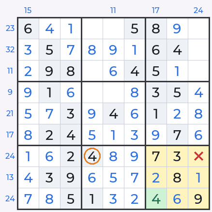

<!-- Written by tools/walkthrough.py sum-skyscrapers: edit the script, not this page. -->
# Sum Skyscrapers, step 43: the 4 in box 9

**Step 43 of 52** · [← Step 42](step-42.md) · [All steps](../sum-skyscrapers.md#the-whole-puzzle-step-by-step) · [Step 44 →](step-44.md)

Box 9 needs a 4. r7c9: row 7 has one (r7c4). Only **r9c7** is left: **r9c7 = 4**.

**Step 43 of 52** · [← Step 42](step-42.md) · [All steps](../sum-skyscrapers.md#the-whole-puzzle-step-by-step) · [Step 44 →](step-44.md)
