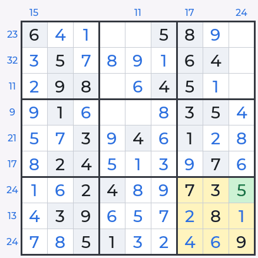

<!-- Written by tools/walkthrough.py sum-skyscrapers: edit the script, not this page. -->
# Sum Skyscrapers, step 44: the 5 in box 9

**Step 44 of 52** · [← Step 43](step-43.md) · [All steps](../sum-skyscrapers.md#the-whole-puzzle-step-by-step) · [Step 45 →](step-45.md)

Box 9 needs a 5, and r7c9 is its last empty cell: **r7c9 = 5**.

**Step 44 of 52** · [← Step 43](step-43.md) · [All steps](../sum-skyscrapers.md#the-whole-puzzle-step-by-step) · [Step 45 →](step-45.md)
