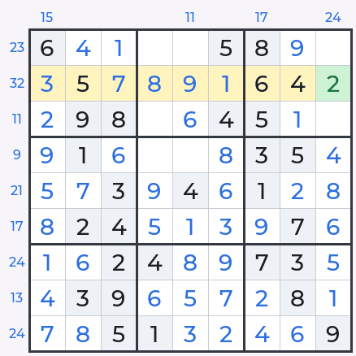

<!-- Written by tools/walkthrough.py sum-skyscrapers: edit the script, not this page. -->
# Sum Skyscrapers, step 45: the 2 in row 2

**Step 45 of 52** · [← Step 44](step-44.md) · [All steps](../sum-skyscrapers.md#the-whole-puzzle-step-by-step) · [Step 46 →](step-46.md)

Row 2 needs a 2, and r2c9 is its last empty cell: **r2c9 = 2**.

**Step 45 of 52** · [← Step 44](step-44.md) · [All steps](../sum-skyscrapers.md#the-whole-puzzle-step-by-step) · [Step 46 →](step-46.md)
