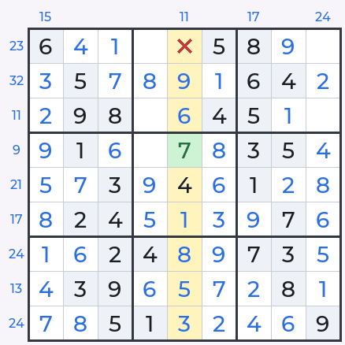

<!-- Written by tools/walkthrough.py sum-skyscrapers: edit the script, not this page. -->
# Sum Skyscrapers, step 46: the 7 in column 5

**Step 46 of 52** · [← Step 45](step-45.md) · [All steps](../sum-skyscrapers.md#the-whole-puzzle-step-by-step) · [Step 47 →](step-47.md)

Column 5 needs a 7. r1c5: it's the first cell after a clue of 11: it's seen, and so is the 9 later, so it's at most 2. Only **r4c5** is left: **r4c5 = 7**.

**Step 46 of 52** · [← Step 45](step-45.md) · [All steps](../sum-skyscrapers.md#the-whole-puzzle-step-by-step) · [Step 47 →](step-47.md)
