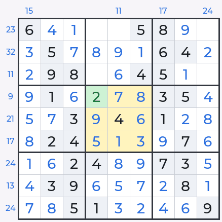

<!-- Written by tools/walkthrough.py sum-skyscrapers: edit the script, not this page. -->
# Sum Skyscrapers, step 47: the 2 in box 5

**Step 47 of 52** · [← Step 46](step-46.md) · [All steps](../sum-skyscrapers.md#the-whole-puzzle-step-by-step) · [Step 48 →](step-48.md)

Box 5 needs a 2, and r4c4 is its last empty cell: **r4c4 = 2**.

**Step 47 of 52** · [← Step 46](step-46.md) · [All steps](../sum-skyscrapers.md#the-whole-puzzle-step-by-step) · [Step 48 →](step-48.md)
