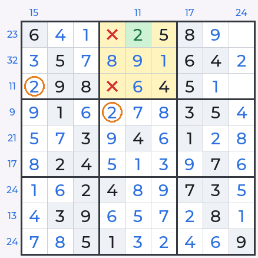

<!-- Written by tools/walkthrough.py sum-skyscrapers: edit the script, not this page. -->
# Sum Skyscrapers, step 48: the 2 in box 2

**Step 48 of 52** · [← Step 47](step-47.md) · [All steps](../sum-skyscrapers.md#the-whole-puzzle-step-by-step) · [Step 49 →](step-49.md)

Box 2 needs a 2. r1c4: column 4 has one (r4c4). r3c4: row 3 has one (r3c1). Only **r1c5** is left: **r1c5 = 2**.

**Step 48 of 52** · [← Step 47](step-47.md) · [All steps](../sum-skyscrapers.md#the-whole-puzzle-step-by-step) · [Step 49 →](step-49.md)
