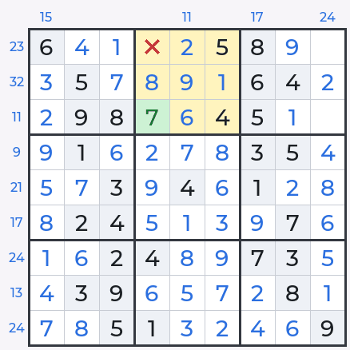

<!-- Written by tools/walkthrough.py sum-skyscrapers: edit the script, not this page. -->
# Sum Skyscrapers, step 49: the 7 in box 2

**Step 49 of 52** · [← Step 48](step-48.md) · [All steps](../sum-skyscrapers.md#the-whole-puzzle-step-by-step) · [Step 50 →](step-50.md)

Box 2 needs a 7. r1c4: seen from the left of row 1, 6, 7, 8 and 9 would already add up to 30, more than its clue 23. Only **r3c4** is left: **r3c4 = 7**.

**Step 49 of 52** · [← Step 48](step-48.md) · [All steps](../sum-skyscrapers.md#the-whole-puzzle-step-by-step) · [Step 50 →](step-50.md)
