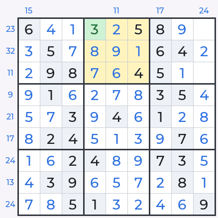

<!-- Written by tools/walkthrough.py sum-skyscrapers: edit the script, not this page. -->
# Sum Skyscrapers, step 50: the 3 in box 2

**Step 50 of 52** · [← Step 49](step-49.md) · [All steps](../sum-skyscrapers.md#the-whole-puzzle-step-by-step) · [Step 51 →](step-51.md)

Box 2 needs a 3, and r1c4 is its last empty cell: **r1c4 = 3**.

**Step 50 of 52** · [← Step 49](step-49.md) · [All steps](../sum-skyscrapers.md#the-whole-puzzle-step-by-step) · [Step 51 →](step-51.md)
