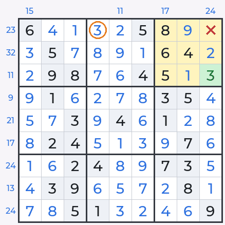

<!-- Written by tools/walkthrough.py sum-skyscrapers: edit the script, not this page. -->
# Sum Skyscrapers, step 51: the 3 in box 3

**Step 51 of 52** · [← Step 50](step-50.md) · [All steps](../sum-skyscrapers.md#the-whole-puzzle-step-by-step) · [Step 52 →](step-52.md)

Box 3 needs a 3. r1c9: row 1 has one (r1c4). Only **r3c9** is left: **r3c9 = 3**.

**Step 51 of 52** · [← Step 50](step-50.md) · [All steps](../sum-skyscrapers.md#the-whole-puzzle-step-by-step) · [Step 52 →](step-52.md)
