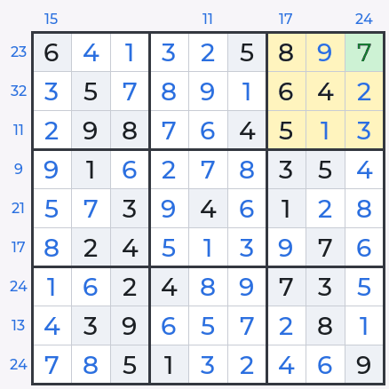

<!-- Written by tools/walkthrough.py sum-skyscrapers: edit the script, not this page. -->
# Sum Skyscrapers, step 52: the 7 in box 3

**Step 52 of 52** · [← Step 51](step-51.md) · [All steps](../sum-skyscrapers.md#the-whole-puzzle-step-by-step) · [All steps](../sum-skyscrapers.md#the-whole-puzzle-step-by-step)

Box 3 needs a 7, and r1c9 is its last empty cell: **r1c9 = 7**.

Solved.

**Step 52 of 52** · [← Step 51](step-51.md) · [All steps](../sum-skyscrapers.md#the-whole-puzzle-step-by-step) · [All steps](../sum-skyscrapers.md#the-whole-puzzle-step-by-step)
