# Sumless Killer

[← All variants](README.md) · [Puzzles](../features-puzzles.md) · [How to play](../how-to-play.md)

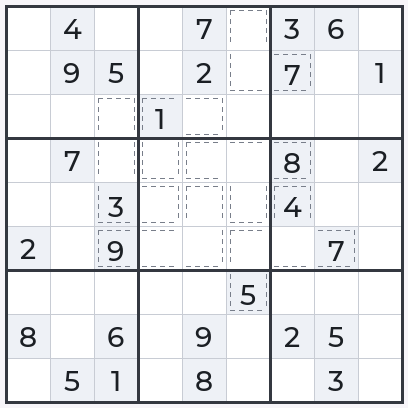

## The rules

[Classic](classic.md) rules, plus **cages** (dashed outlines) **without sums**: no digit repeats in a cage. That's all a cage says, so a cage inside one box would say nothing new: every cage reaches over a box border (or across rows and columns), joining cells that otherwise don't see each other.

## On the board

- The cages are dashed outlines, like Killer's, with no number in the corner. Not every cell is in a cage.
- Two of the same digit in a cage turn red, as in a row.
- The hints count a cage as one more group the cell is in: "the row, column, box or cage".
- **Puzzles → ⋮ → New puzzle → Clues → Sumless**: cages of 2 to 5 cells. Without sums, a puzzle keeps more givens than a Killer.

## How to solve it

- **A cage is a short extra group:** scan it like a row. A digit in one of its cells rules that digit out of the rest, even in the next box.
- **Hidden singles across the border:** a cage often leaves a box with one place for a digit, as in the example below.
- **Pairs travel:** two cells of a cage that can only be 3 or 7 keep 3 and 7 out of the cage's other cells.

## Worked example

**variant-examples #47**, Sumless Killer Easy (see [Classic](classic.md#worked-example-the-whole-puzzle) for how to import the examples; cells are written r*row*c*column*).

**Step 1: the 5 in column 7.** r1c7, r2c7, r4c7, r5c7 and r8c7 are filled. r7c7: row 7 has a 5 (r7c6). r9c7: row 9 has one (r9c2). r6c7 is in no row, column or box with a 5, but its cage (r5c7, r6c6, r6c7, r6c8, r7c6) reaches down into box 8, where r7c6 holds 5. Only **r3c7** is left: **r3c7 = 5**.

**Step 2: the 1 in box 1**, by the Classic rules alone: column 3 has a 1 (r9c3), row 2 one (r2c9), row 3 one (r3c4), and the rest of the box is filled. **r1c1 = 1**.

**Step 3: the 5 in box 2**: row 2 has one (r2c3), row 3 one (r3c7, from step 1), column 6 one (r7c6), and r1c5, r2c5 and r3c4 are filled. **r1c4 = 5**.

## The whole puzzle, step by step

<!-- walkthrough -->
<!-- Written by tools/walkthrough.py sumless-killer: edit the script, not this part. -->

The whole puzzle, from the start to the last cell: 53 steps, each one a single (one place left for a digit, or one digit left for a cell), taken in the order a box's single comes first, so not quite the order of the worked example above. In each picture, the unit the step looks at is tinted yellow (for a cell with one digit left: its row, column and box), the new digit is on green, the digits that rule cells out have an **orange ring**, and the empty cells they rule out a **red cross**. Givens are on grey, digits from earlier steps in blue.

#### Step 1: the 1 in box 1

Box 1 needs a 1. r1c3: column 3 has one (r9c3). r2c1: row 2 has one (r2c9). r3c1, r3c2 and r3c3: row 3 has one (r3c4). Only **r1c1** is left: **r1c1 = 1**.

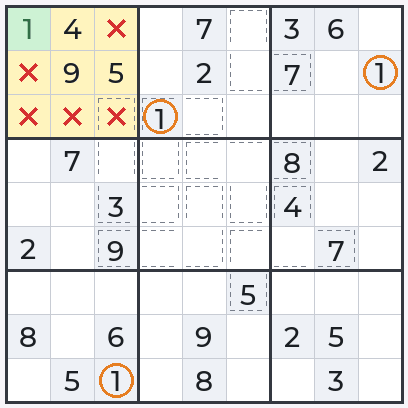

#### Step 2: the 2 in box 3

Box 3 needs a 2. r1c9 and r3c9: column 9 has one (r4c9). r2c8: row 2 has one (r2c5). r3c7: column 7 has one (r8c7). Only **r3c8** is left: **r3c8 = 2**.

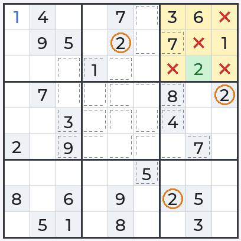

#### Step 3: the 2 in box 1

Box 1 needs a 2. r2c1: row 2 has one (r2c5). r3c1, r3c2 and r3c3: row 3 has one (r3c8). Only **r1c3** is left: **r1c3 = 2**.

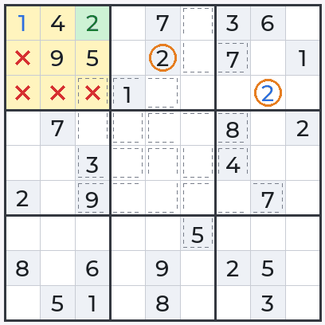

#### Step 4: the 3 in box 6

Box 6 needs a 3. r4c8: column 8 has one (r9c8). r5c8 and r5c9: row 5 has one (r5c3). r6c7: column 7 has one (r1c7). Only **r6c9** is left: **r6c9 = 3**.

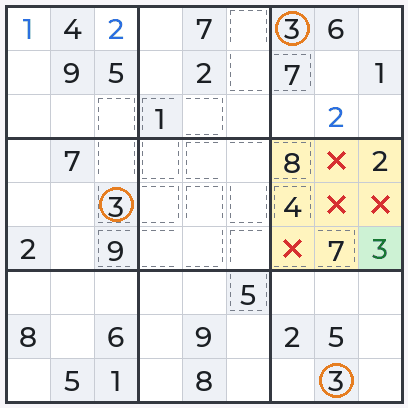

#### Step 5: the 5 in box 6

Box 6 needs a 5. r4c8 and r5c8: column 8 has one (r8c8). r6c7: the 5 in r7c6 is in the same cage. Only **r5c9** is left: **r5c9 = 5**.

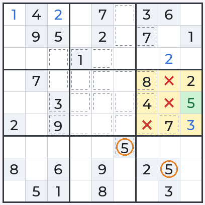

#### Step 6: the 5 in box 3

Box 3 needs a 5. r1c9 and r3c9: column 9 has one (r5c9). r2c8: row 2 has one (r2c3). Only **r3c7** is left: **r3c7 = 5**.

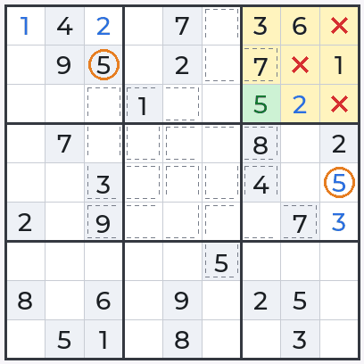

#### Step 7: the 5 in box 2

Box 2 needs a 5. r1c6: column 6 has one (r7c6). r2c4 and r2c6: row 2 has one (r2c3). r3c5 and r3c6: row 3 has one (r3c7). Only **r1c4** is left: **r1c4 = 5**.

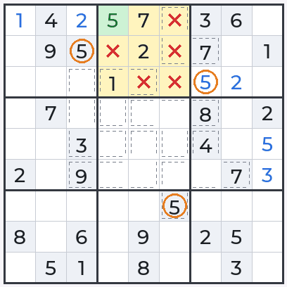

#### Step 8: the 5 in box 4

Box 4 needs a 5. r4c3: column 3 has one (r2c3). r5c1 and r5c2: row 5 has one (r5c9). r6c2: column 2 has one (r9c2). Only **r4c1** is left: **r4c1 = 5**.

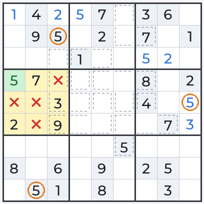

#### Step 9: the 4 in box 4

Box 4 needs a 4. r5c1 and r5c2: row 5 has one (r5c7). r6c2: column 2 has one (r1c2). Only **r4c3** is left: **r4c3 = 4**.

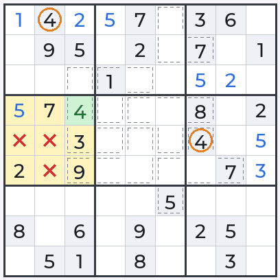

#### Step 10: the 5 in box 5

Box 5 needs a 5. r4c4, r4c5 and r4c6: row 4 has one (r4c1). r5c4, r5c5 and r5c6: row 5 has one (r5c9). r6c4: column 4 has one (r1c4). r6c6: column 6 has one (r7c6). Only **r6c5** is left: **r6c5 = 5**.

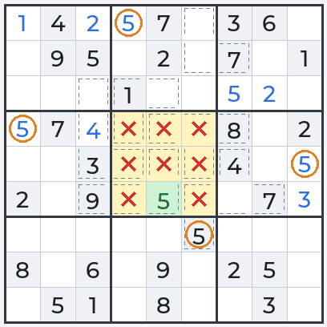

#### Step 11: the 4 in box 5

Box 5 needs a 4. r4c4, r4c5 and r4c6: row 4 has one (r4c3). r5c4, r5c5 and r5c6: row 5 has one (r5c7). r6c6: the 4 in r5c7 is in the same cage. Only **r6c4** is left: **r6c4 = 4**.

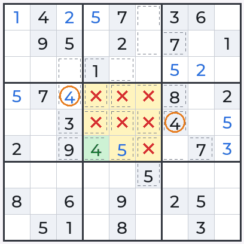

#### Step 12: the 6 in box 6

Box 6 needs a 6. r4c8 and r5c8: column 8 has one (r1c8). Only **r6c7** is left: **r6c7 = 6**.

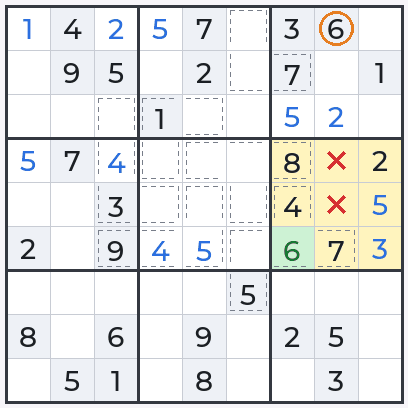

#### Step 13: the 2 in box 7

Box 7 needs a 2. r7c1 and r9c1: column 1 has one (r6c1). r7c3: column 3 has one (r1c3). r8c2: row 8 has one (r8c7). Only **r7c2** is left: **r7c2 = 2**.

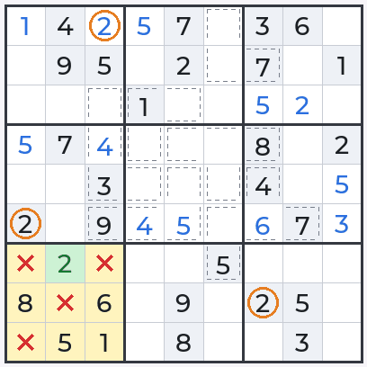

#### Step 14: the 1 in row 8

Row 8 needs a 1. r8c2: box 7 has one (r9c3). r8c4: column 4 has one (r3c4). r8c9: column 9 has one (r2c9). Only **r8c6** is left: **r8c6 = 1**.

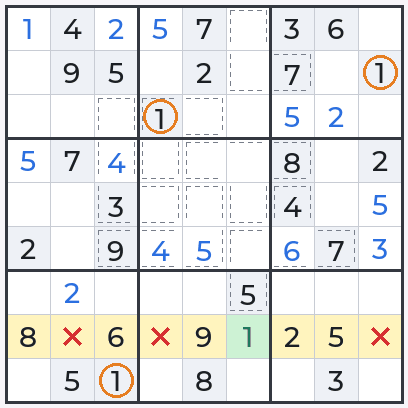

#### Step 15: the 1 in row 6

Row 6 needs a 1. r6c6: column 6 has one (r8c6). Only **r6c2** is left: **r6c2 = 1**.

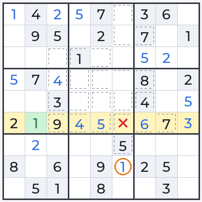

#### Step 16: the 8 in box 4

Box 4 needs an 8. r5c1: column 1 has one (r8c1). Only **r5c2** is left: **r5c2 = 8**.

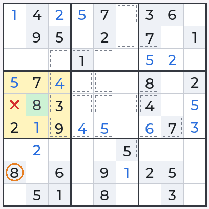

#### Step 17: the 8 in box 1

Box 1 needs an 8. r2c1 and r3c1: column 1 has one (r8c1). r3c2: column 2 has one (r5c2). Only **r3c3** is left: **r3c3 = 8**.

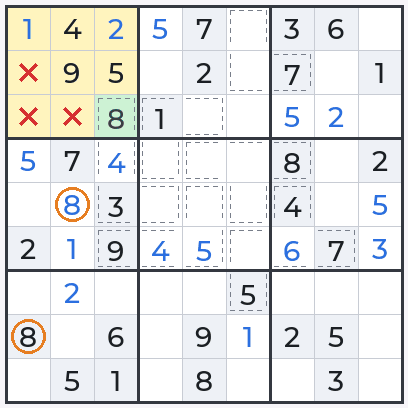

#### Step 18: the 7 in box 1

Box 1 needs a 7. r2c1: row 2 has one (r2c7). r3c2: column 2 has one (r4c2). Only **r3c1** is left: **r3c1 = 7**.

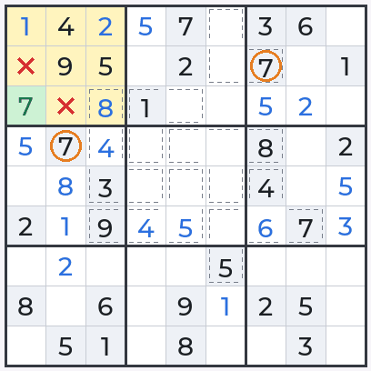

#### Step 19: the 6 in box 4

Box 4 needs a 6, and r5c1 is its last empty cell: **r5c1 = 6**.

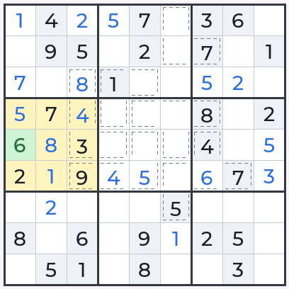

#### Step 20: the 6 in box 1

Box 1 needs a 6. r2c1: column 1 has one (r5c1). Only **r3c2** is left: **r3c2 = 6**.

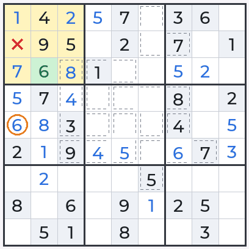

#### Step 21: the 3 in box 1

Box 1 needs a 3, and r2c1 is its last empty cell: **r2c1 = 3**.

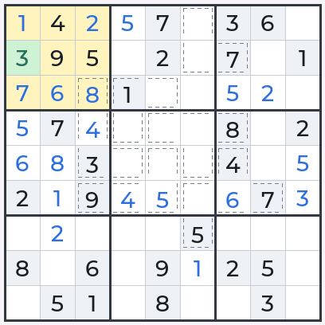

#### Step 22: the 8 in box 5

Box 5 needs an 8. r4c4, r4c5 and r4c6: row 4 has one (r4c7). r5c4, r5c5 and r5c6: row 5 has one (r5c2). Only **r6c6** is left: **r6c6 = 8**.

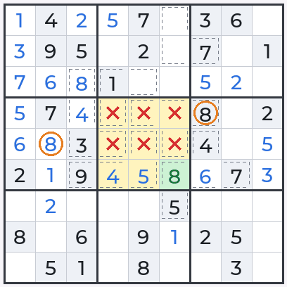

#### Step 23: the 8 in box 2

Box 2 needs an 8. r1c6 and r2c6: column 6 has one (r6c6). r3c5 and r3c6: row 3 has one (r3c3). Only **r2c4** is left: **r2c4 = 8**.

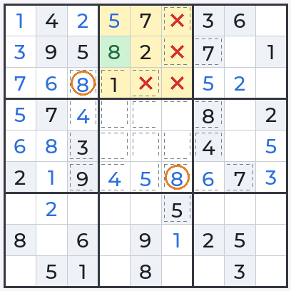

#### Step 24: the 6 in box 2

Box 2 needs a 6. r1c6: row 1 has one (r1c8). r3c5 and r3c6: row 3 has one (r3c2). Only **r2c6** is left: **r2c6 = 6**.

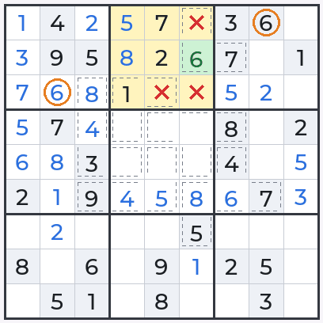

#### Step 25: the 8 in box 3

Box 3 needs an 8. r2c8: row 2 has one (r2c4). r3c9: row 3 has one (r3c3). Only **r1c9** is left: **r1c9 = 8**.

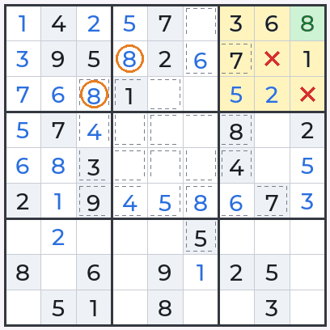

#### Step 26: the 9 in box 3

Box 3 needs a 9. r2c8: row 2 has one (r2c2). Only **r3c9** is left: **r3c9 = 9**.

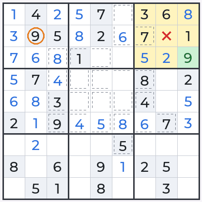

#### Step 27: the 9 in box 2

Box 2 needs a 9. r3c5 and r3c6: row 3 has one (r3c9). Only **r1c6** is left: **r1c6 = 9**.

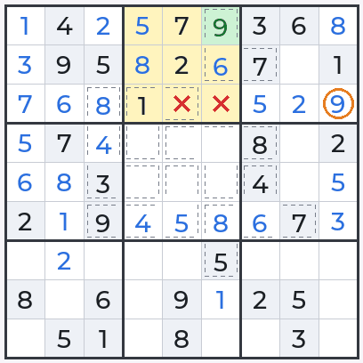

#### Step 28: the 4 in box 3

Box 3 needs a 4, and r2c8 is its last empty cell: **r2c8 = 4**.

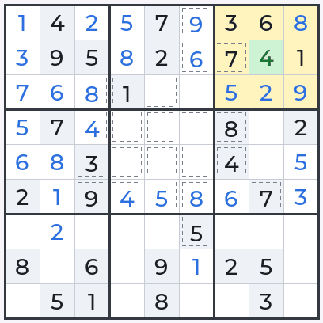

#### Step 29: the 3 in box 7

Box 7 needs a 3. r7c1: column 1 has one (r2c1). r7c3: column 3 has one (r5c3). r9c1: row 9 has one (r9c8). Only **r8c2** is left: **r8c2 = 3**.

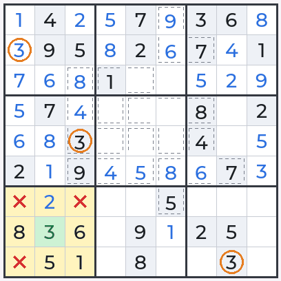

#### Step 30: the 7 in box 7

Box 7 needs a 7. r7c1 and r9c1: column 1 has one (r3c1). Only **r7c3** is left: **r7c3 = 7**.

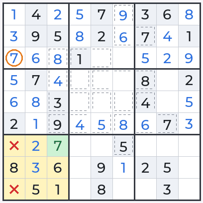

#### Step 31: the 8 in box 9

Box 9 needs an 8. r7c7: column 7 has one (r4c7). r7c9: column 9 has one (r1c9). r8c9: row 8 has one (r8c1). r9c7 and r9c9: row 9 has one (r9c5). Only **r7c8** is left: **r7c8 = 8**.

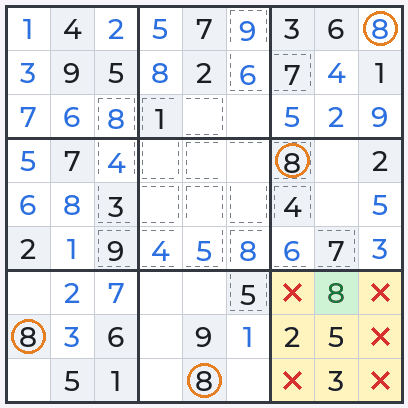

#### Step 32: the 1 in box 9

Box 9 needs a 1. r7c9: column 9 has one (r2c9). r8c9: row 8 has one (r8c6). r9c7 and r9c9: row 9 has one (r9c3). Only **r7c7** is left: **r7c7 = 1**.

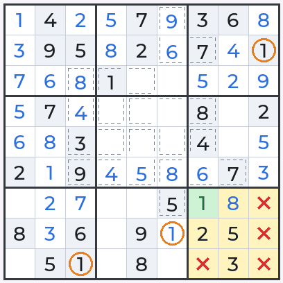

#### Step 33: the 9 in box 9

Box 9 needs a 9. r7c9 and r9c9: column 9 has one (r3c9). r8c9: row 8 has one (r8c5). Only **r9c7** is left: **r9c7 = 9**.

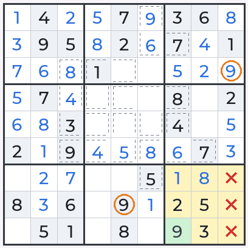

#### Step 34: the 9 in box 7

Box 7 needs a 9. r9c1: row 9 has one (r9c7). Only **r7c1** is left: **r7c1 = 9**.

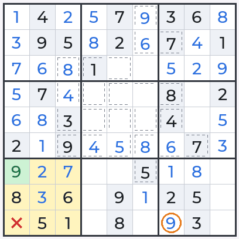

#### Step 35: the 4 in box 7

Box 7 needs a 4, and r9c1 is its last empty cell: **r9c1 = 4**.

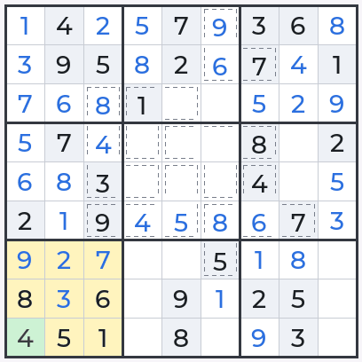

#### Step 36: the 4 in box 8

Box 8 needs a 4. r7c4 and r8c4: column 4 has one (r6c4). r9c4 and r9c6: row 9 has one (r9c1). Only **r7c5** is left: **r7c5 = 4**.

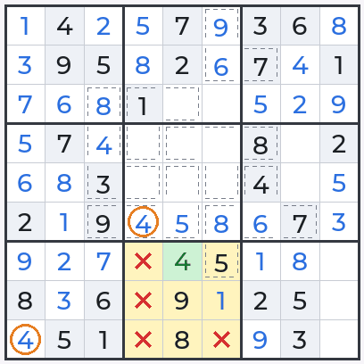

#### Step 37: the 4 in box 2

Box 2 needs a 4. r3c5: column 5 has one (r7c5). Only **r3c6** is left: **r3c6 = 4**.

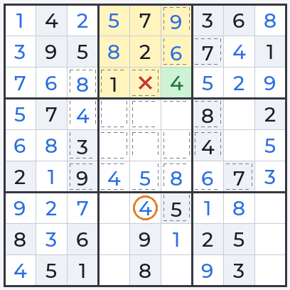

#### Step 38: the 3 in box 2

Box 2 needs a 3, and r3c5 is its last empty cell: **r3c5 = 3**.

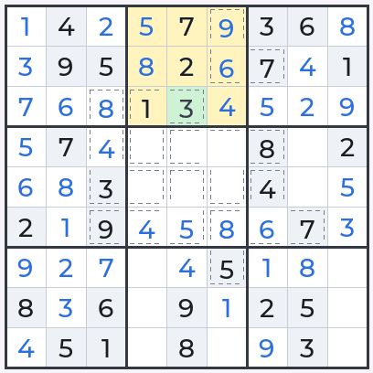

#### Step 39: the 3 in box 5

Box 5 needs a 3. r4c4: the 3 in r3c5 is in the same cage. r4c5: column 5 has one (r3c5). r5c4, r5c5 and r5c6: row 5 has one (r5c3). Only **r4c6** is left: **r4c6 = 3**.

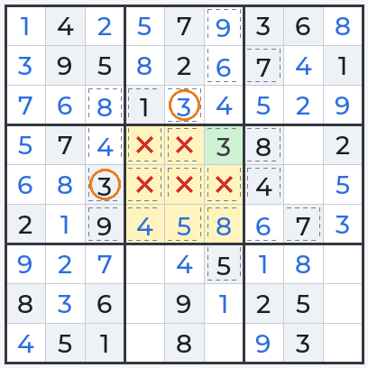

#### Step 40: the 3 in box 8

Box 8 needs a 3. r8c4: row 8 has one (r8c2). r9c4 and r9c6: row 9 has one (r9c8). Only **r7c4** is left: **r7c4 = 3**.

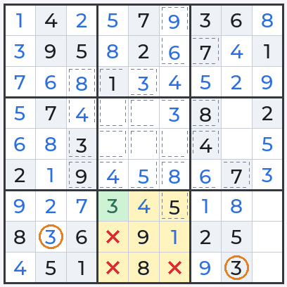

#### Step 41: the 6 in box 8

Box 8 needs a 6. r8c4: row 8 has one (r8c3). r9c6: column 6 has one (r2c6). Only **r9c4** is left: **r9c4 = 6**.

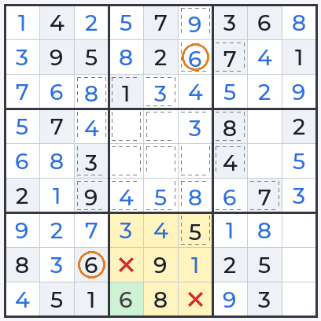

#### Step 42: the 6 in box 5

Box 5 needs a 6. r4c4: column 4 has one (r9c4). r5c4, r5c5 and r5c6: row 5 has one (r5c1). Only **r4c5** is left: **r4c5 = 6**.

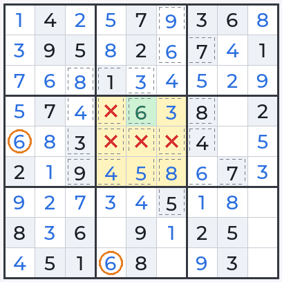

#### Step 43: the 1 in box 5

Box 5 needs a 1. r4c4 and r5c4: column 4 has one (r3c4). r5c6: column 6 has one (r8c6). Only **r5c5** is left: **r5c5 = 1**.

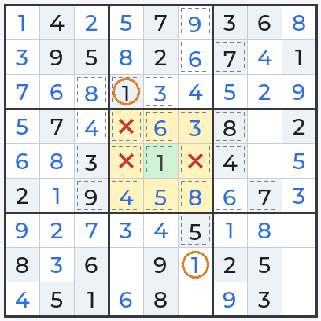

#### Step 44: the 1 in box 6

Box 6 needs a 1. r5c8: row 5 has one (r5c5). Only **r4c8** is left: **r4c8 = 1**.

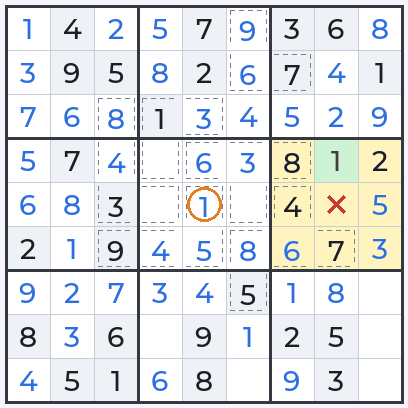

#### Step 45: the 9 in box 6

Box 6 needs a 9, and r5c8 is its last empty cell: **r5c8 = 9**.

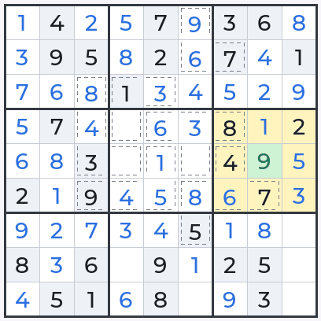

#### Step 46: the 9 in box 5

Box 5 needs a 9. r5c4 and r5c6: row 5 has one (r5c8). Only **r4c4** is left: **r4c4 = 9**.

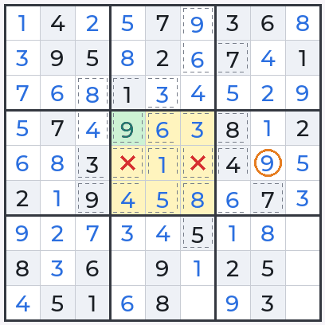

#### Step 47: the 2 in box 8

Box 8 needs a 2. r8c4: row 8 has one (r8c7). Only **r9c6** is left: **r9c6 = 2**.

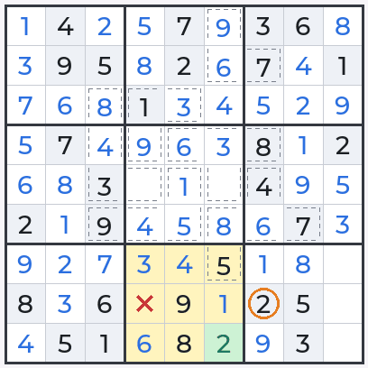

#### Step 48: the 2 in box 5

Box 5 needs a 2. r5c6: column 6 has one (r9c6). Only **r5c4** is left: **r5c4 = 2**.

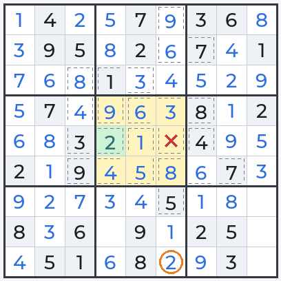

#### Step 49: the 7 in box 5

Box 5 needs a 7, and r5c6 is its last empty cell: **r5c6 = 7**.

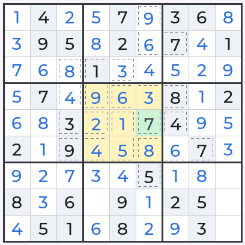

#### Step 50: the 7 in box 8

Box 8 needs a 7, and r8c4 is its last empty cell: **r8c4 = 7**.

#### Step 51: the 4 in box 9

Box 9 needs a 4. r7c9: row 7 has one (r7c5). r9c9: row 9 has one (r9c1). Only **r8c9** is left: **r8c9 = 4**.

#### Step 52: the 6 in box 9

Box 9 needs a 6. r9c9: row 9 has one (r9c4). Only **r7c9** is left: **r7c9 = 6**.

#### Step 53: the 7 in box 9

Box 9 needs a 7, and r9c9 is its last empty cell: **r9c9 = 7**.

Solved.

<!-- /walkthrough -->
