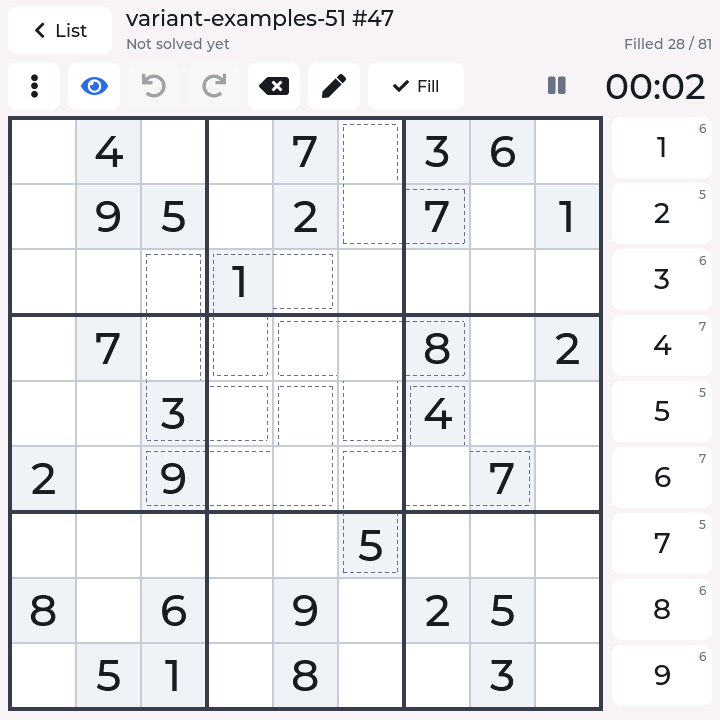

# Sumless Killer

[← All variants](README.md) · [Puzzles](../features-puzzles.md) · [How to play](../how-to-play.md)

## The rules

[Classic](classic.md) rules, plus **cages** (dashed outlines) **without sums**: no digit repeats in a cage. That's all a cage says, so a cage inside one box would say nothing new: every cage reaches over a box border (or across rows and columns), joining cells that otherwise don't see each other.

## On the board

- The cages are dashed outlines, like Killer's, with no number in the corner. Not every cell is in a cage.
- Two of the same digit in a cage turn red, as in a row.
- The hints count a cage as one more group the cell is in: "the row, column, box or cage".
- **Puzzles → ⋮ → New puzzle → Clues → Sumless**: cages of 2 to 5 cells. Without sums, a puzzle keeps more givens than a Killer.

## How to solve it

- **A cage is a short extra group:** scan it like a row. A digit in one of its cells rules that digit out of the rest, even in the next box.
- **Hidden singles across the border:** a cage often leaves a box with one place for a digit, as in the example below.
- **Pairs travel:** two cells of a cage that can only be 3 or 7 keep 3 and 7 out of the cage's other cells.

## Worked example

**variant-examples #47**, Sumless Killer Easy (see [Classic](classic.md#worked-example-the-whole-puzzle) for how to import the examples; cells are written r*row*c*column*).

**Step 1: the 5 in column 7.** r1c7, r2c7, r4c7, r5c7 and r8c7 are filled. r7c7: row 7 has a 5 (r7c6). r9c7: row 9 has one (r9c2). r6c7 is in no row, column or box with a 5, but its cage (r5c7, r6c6, r6c7, r6c8, r7c6) reaches down into box 8, where r7c6 holds 5. Only **r3c7** is left: **r3c7 = 5**.

**Step 2: the 1 in box 1**, by the Classic rules alone: column 3 has a 1 (r9c3), row 2 one (r2c9), row 3 one (r3c4), and the rest of the box is filled. **r1c1 = 1**.

**Step 3: the 5 in box 2**: row 2 has one (r2c3), row 3 one (r3c7, from step 1), column 6 one (r7c6), and r1c5, r2c5 and r3c4 are filled. **r1c4 = 5**.

## The whole puzzle, step by step

<!-- walkthrough -->
<!-- Written by tools/walkthrough.py sumless-killer: edit the script, not this part. -->

The whole puzzle, from the start to the last cell: 53 steps, each one a single (one place left for a digit, or one digit left for a cell), taken in the order a box's single comes first, so not quite the order of the worked example above. Each step has a page of its own, with **Previous** and **Next**: pick one from the list below. In each picture, the unit the step looks at is tinted yellow (for a cell with one digit left: its row, column and box), the new digit is on green, the digits that rule cells out have an **orange ring**, and the empty cells they rule out a **red cross**. Givens are on grey, digits from earlier steps in blue.

1. [the 1 in box 1](sumless-killer/step-01.md)
2. [the 2 in box 3](sumless-killer/step-02.md)
3. [the 2 in box 1](sumless-killer/step-03.md)
4. [the 3 in box 6](sumless-killer/step-04.md)
5. [the 5 in box 6](sumless-killer/step-05.md)
6. [the 5 in box 3](sumless-killer/step-06.md)
7. [the 5 in box 2](sumless-killer/step-07.md)
8. [the 5 in box 4](sumless-killer/step-08.md)
9. [the 4 in box 4](sumless-killer/step-09.md)
10. [the 5 in box 5](sumless-killer/step-10.md)
11. [the 4 in box 5](sumless-killer/step-11.md)
12. [the 6 in box 6](sumless-killer/step-12.md)
13. [the 2 in box 7](sumless-killer/step-13.md)
14. [the 1 in row 8](sumless-killer/step-14.md)
15. [the 1 in row 6](sumless-killer/step-15.md)
16. [the 8 in box 4](sumless-killer/step-16.md)
17. [the 8 in box 1](sumless-killer/step-17.md)
18. [the 7 in box 1](sumless-killer/step-18.md)
19. [the 6 in box 4](sumless-killer/step-19.md)
20. [the 6 in box 1](sumless-killer/step-20.md)
21. [the 3 in box 1](sumless-killer/step-21.md)
22. [the 8 in box 5](sumless-killer/step-22.md)
23. [the 8 in box 2](sumless-killer/step-23.md)
24. [the 6 in box 2](sumless-killer/step-24.md)
25. [the 8 in box 3](sumless-killer/step-25.md)
26. [the 9 in box 3](sumless-killer/step-26.md)
27. [the 9 in box 2](sumless-killer/step-27.md)
28. [the 4 in box 3](sumless-killer/step-28.md)
29. [the 3 in box 7](sumless-killer/step-29.md)
30. [the 7 in box 7](sumless-killer/step-30.md)
31. [the 8 in box 9](sumless-killer/step-31.md)
32. [the 1 in box 9](sumless-killer/step-32.md)
33. [the 9 in box 9](sumless-killer/step-33.md)
34. [the 9 in box 7](sumless-killer/step-34.md)
35. [the 4 in box 7](sumless-killer/step-35.md)
36. [the 4 in box 8](sumless-killer/step-36.md)
37. [the 4 in box 2](sumless-killer/step-37.md)
38. [the 3 in box 2](sumless-killer/step-38.md)
39. [the 3 in box 5](sumless-killer/step-39.md)
40. [the 3 in box 8](sumless-killer/step-40.md)
41. [the 6 in box 8](sumless-killer/step-41.md)
42. [the 6 in box 5](sumless-killer/step-42.md)
43. [the 1 in box 5](sumless-killer/step-43.md)
44. [the 1 in box 6](sumless-killer/step-44.md)
45. [the 9 in box 6](sumless-killer/step-45.md)
46. [the 9 in box 5](sumless-killer/step-46.md)
47. [the 2 in box 8](sumless-killer/step-47.md)
48. [the 2 in box 5](sumless-killer/step-48.md)
49. [the 7 in box 5](sumless-killer/step-49.md)
50. [the 7 in box 8](sumless-killer/step-50.md)
51. [the 4 in box 9](sumless-killer/step-51.md)
52. [the 6 in box 9](sumless-killer/step-52.md)
53. [the 7 in box 9](sumless-killer/step-53.md)

Solved.

<!-- /walkthrough -->
