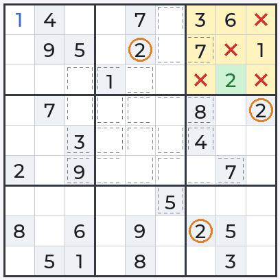

<!-- Written by tools/walkthrough.py sumless-killer: edit the script, not this page. -->
# Sumless Killer, step 2: the 2 in box 3

**Step 2 of 53** · [← Step 1](step-01.md) · [All steps](../sumless-killer.md#the-whole-puzzle-step-by-step) · [Step 3 →](step-03.md)

Box 3 needs a 2. r1c9 and r3c9: column 9 has one (r4c9). r2c8: row 2 has one (r2c5). r3c7: column 7 has one (r8c7). Only **r3c8** is left: **r3c8 = 2**.

**Step 2 of 53** · [← Step 1](step-01.md) · [All steps](../sumless-killer.md#the-whole-puzzle-step-by-step) · [Step 3 →](step-03.md)
