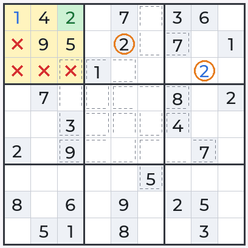

<!-- Written by tools/walkthrough.py sumless-killer: edit the script, not this page. -->
# Sumless Killer, step 3: the 2 in box 1

**Step 3 of 53** · [← Step 2](step-02.md) · [All steps](../sumless-killer.md#the-whole-puzzle-step-by-step) · [Step 4 →](step-04.md)

Box 1 needs a 2. r2c1: row 2 has one (r2c5). r3c1, r3c2 and r3c3: row 3 has one (r3c8). Only **r1c3** is left: **r1c3 = 2**.

**Step 3 of 53** · [← Step 2](step-02.md) · [All steps](../sumless-killer.md#the-whole-puzzle-step-by-step) · [Step 4 →](step-04.md)
