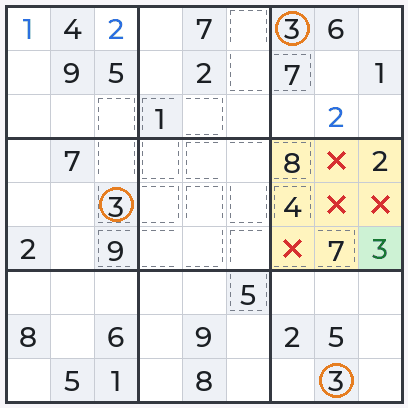

<!-- Written by tools/walkthrough.py sumless-killer: edit the script, not this page. -->
# Sumless Killer, step 4: the 3 in box 6

**Step 4 of 53** · [← Step 3](step-03.md) · [All steps](../sumless-killer.md#the-whole-puzzle-step-by-step) · [Step 5 →](step-05.md)

Box 6 needs a 3. r4c8: column 8 has one (r9c8). r5c8 and r5c9: row 5 has one (r5c3). r6c7: column 7 has one (r1c7). Only **r6c9** is left: **r6c9 = 3**.

**Step 4 of 53** · [← Step 3](step-03.md) · [All steps](../sumless-killer.md#the-whole-puzzle-step-by-step) · [Step 5 →](step-05.md)
