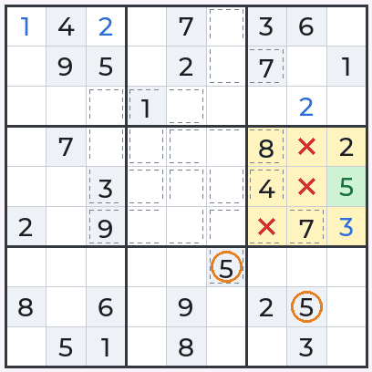

<!-- Written by tools/walkthrough.py sumless-killer: edit the script, not this page. -->
# Sumless Killer, step 5: the 5 in box 6

**Step 5 of 53** · [← Step 4](step-04.md) · [All steps](../sumless-killer.md#the-whole-puzzle-step-by-step) · [Step 6 →](step-06.md)

Box 6 needs a 5. r4c8 and r5c8: column 8 has one (r8c8). r6c7: the 5 in r7c6 is in the same cage. Only **r5c9** is left: **r5c9 = 5**.

**Step 5 of 53** · [← Step 4](step-04.md) · [All steps](../sumless-killer.md#the-whole-puzzle-step-by-step) · [Step 6 →](step-06.md)
