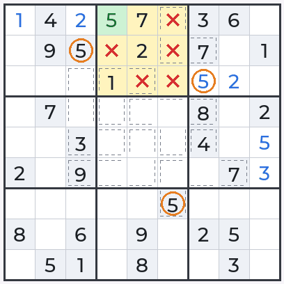

<!-- Written by tools/walkthrough.py sumless-killer: edit the script, not this page. -->
# Sumless Killer, step 7: the 5 in box 2

**Step 7 of 53** · [← Step 6](step-06.md) · [All steps](../sumless-killer.md#the-whole-puzzle-step-by-step) · [Step 8 →](step-08.md)

Box 2 needs a 5. r1c6: column 6 has one (r7c6). r2c4 and r2c6: row 2 has one (r2c3). r3c5 and r3c6: row 3 has one (r3c7). Only **r1c4** is left: **r1c4 = 5**.

**Step 7 of 53** · [← Step 6](step-06.md) · [All steps](../sumless-killer.md#the-whole-puzzle-step-by-step) · [Step 8 →](step-08.md)
