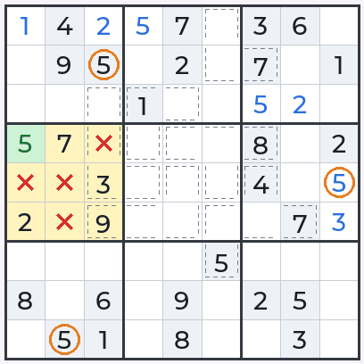

<!-- Written by tools/walkthrough.py sumless-killer: edit the script, not this page. -->
# Sumless Killer, step 8: the 5 in box 4

**Step 8 of 53** · [← Step 7](step-07.md) · [All steps](../sumless-killer.md#the-whole-puzzle-step-by-step) · [Step 9 →](step-09.md)

Box 4 needs a 5. r4c3: column 3 has one (r2c3). r5c1 and r5c2: row 5 has one (r5c9). r6c2: column 2 has one (r9c2). Only **r4c1** is left: **r4c1 = 5**.

**Step 8 of 53** · [← Step 7](step-07.md) · [All steps](../sumless-killer.md#the-whole-puzzle-step-by-step) · [Step 9 →](step-09.md)
