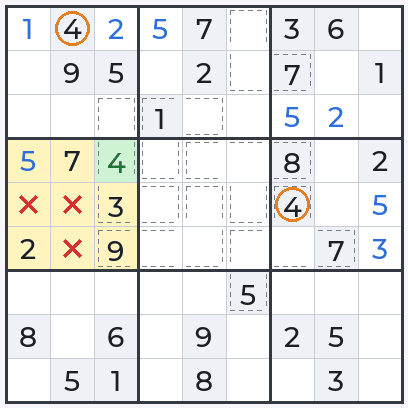

<!-- Written by tools/walkthrough.py sumless-killer: edit the script, not this page. -->
# Sumless Killer, step 9: the 4 in box 4

**Step 9 of 53** · [← Step 8](step-08.md) · [All steps](../sumless-killer.md#the-whole-puzzle-step-by-step) · [Step 10 →](step-10.md)

Box 4 needs a 4. r5c1 and r5c2: row 5 has one (r5c7). r6c2: column 2 has one (r1c2). Only **r4c3** is left: **r4c3 = 4**.

**Step 9 of 53** · [← Step 8](step-08.md) · [All steps](../sumless-killer.md#the-whole-puzzle-step-by-step) · [Step 10 →](step-10.md)
