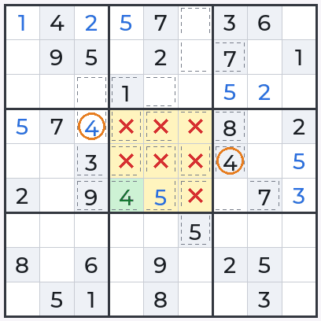

<!-- Written by tools/walkthrough.py sumless-killer: edit the script, not this page. -->
# Sumless Killer, step 11: the 4 in box 5

**Step 11 of 53** · [← Step 10](step-10.md) · [All steps](../sumless-killer.md#the-whole-puzzle-step-by-step) · [Step 12 →](step-12.md)

Box 5 needs a 4. r4c4, r4c5 and r4c6: row 4 has one (r4c3). r5c4, r5c5 and r5c6: row 5 has one (r5c7). r6c6: the 4 in r5c7 is in the same cage. Only **r6c4** is left: **r6c4 = 4**.

**Step 11 of 53** · [← Step 10](step-10.md) · [All steps](../sumless-killer.md#the-whole-puzzle-step-by-step) · [Step 12 →](step-12.md)
