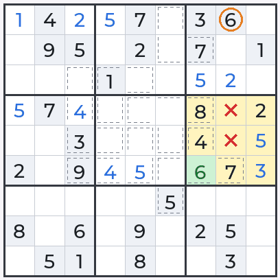

<!-- Written by tools/walkthrough.py sumless-killer: edit the script, not this page. -->
# Sumless Killer, step 12: the 6 in box 6

**Step 12 of 53** · [← Step 11](step-11.md) · [All steps](../sumless-killer.md#the-whole-puzzle-step-by-step) · [Step 13 →](step-13.md)

Box 6 needs a 6. r4c8 and r5c8: column 8 has one (r1c8). Only **r6c7** is left: **r6c7 = 6**.

**Step 12 of 53** · [← Step 11](step-11.md) · [All steps](../sumless-killer.md#the-whole-puzzle-step-by-step) · [Step 13 →](step-13.md)
