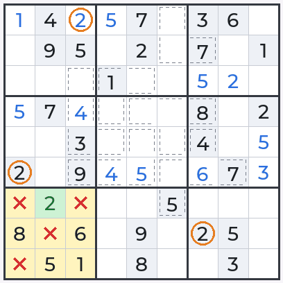

<!-- Written by tools/walkthrough.py sumless-killer: edit the script, not this page. -->
# Sumless Killer, step 13: the 2 in box 7

**Step 13 of 53** · [← Step 12](step-12.md) · [All steps](../sumless-killer.md#the-whole-puzzle-step-by-step) · [Step 14 →](step-14.md)

Box 7 needs a 2. r7c1 and r9c1: column 1 has one (r6c1). r7c3: column 3 has one (r1c3). r8c2: row 8 has one (r8c7). Only **r7c2** is left: **r7c2 = 2**.

**Step 13 of 53** · [← Step 12](step-12.md) · [All steps](../sumless-killer.md#the-whole-puzzle-step-by-step) · [Step 14 →](step-14.md)
