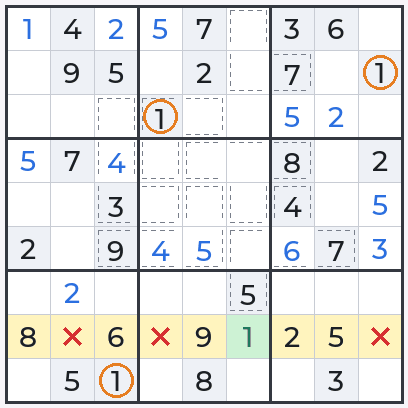

<!-- Written by tools/walkthrough.py sumless-killer: edit the script, not this page. -->
# Sumless Killer, step 14: the 1 in row 8

**Step 14 of 53** · [← Step 13](step-13.md) · [All steps](../sumless-killer.md#the-whole-puzzle-step-by-step) · [Step 15 →](step-15.md)

Row 8 needs a 1. r8c2: box 7 has one (r9c3). r8c4: column 4 has one (r3c4). r8c9: column 9 has one (r2c9). Only **r8c6** is left: **r8c6 = 1**.

**Step 14 of 53** · [← Step 13](step-13.md) · [All steps](../sumless-killer.md#the-whole-puzzle-step-by-step) · [Step 15 →](step-15.md)
