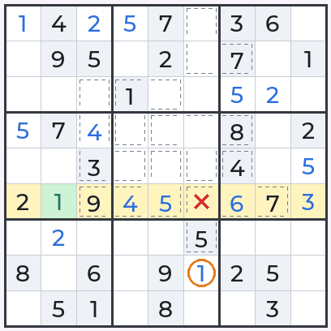

<!-- Written by tools/walkthrough.py sumless-killer: edit the script, not this page. -->
# Sumless Killer, step 15: the 1 in row 6

**Step 15 of 53** · [← Step 14](step-14.md) · [All steps](../sumless-killer.md#the-whole-puzzle-step-by-step) · [Step 16 →](step-16.md)

Row 6 needs a 1. r6c6: column 6 has one (r8c6). Only **r6c2** is left: **r6c2 = 1**.

**Step 15 of 53** · [← Step 14](step-14.md) · [All steps](../sumless-killer.md#the-whole-puzzle-step-by-step) · [Step 16 →](step-16.md)
