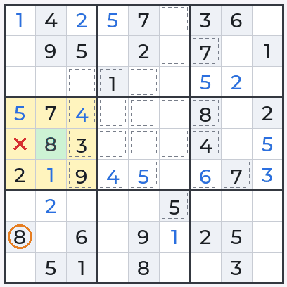

<!-- Written by tools/walkthrough.py sumless-killer: edit the script, not this page. -->
# Sumless Killer, step 16: the 8 in box 4

**Step 16 of 53** · [← Step 15](step-15.md) · [All steps](../sumless-killer.md#the-whole-puzzle-step-by-step) · [Step 17 →](step-17.md)

Box 4 needs an 8. r5c1: column 1 has one (r8c1). Only **r5c2** is left: **r5c2 = 8**.

**Step 16 of 53** · [← Step 15](step-15.md) · [All steps](../sumless-killer.md#the-whole-puzzle-step-by-step) · [Step 17 →](step-17.md)
