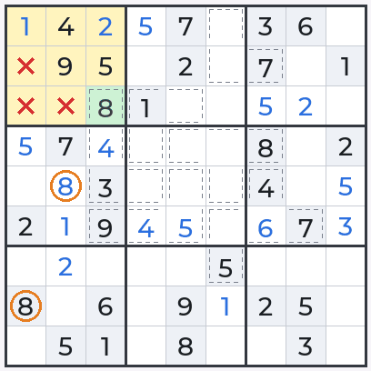

<!-- Written by tools/walkthrough.py sumless-killer: edit the script, not this page. -->
# Sumless Killer, step 17: the 8 in box 1

**Step 17 of 53** · [← Step 16](step-16.md) · [All steps](../sumless-killer.md#the-whole-puzzle-step-by-step) · [Step 18 →](step-18.md)

Box 1 needs an 8. r2c1 and r3c1: column 1 has one (r8c1). r3c2: column 2 has one (r5c2). Only **r3c3** is left: **r3c3 = 8**.

**Step 17 of 53** · [← Step 16](step-16.md) · [All steps](../sumless-killer.md#the-whole-puzzle-step-by-step) · [Step 18 →](step-18.md)
