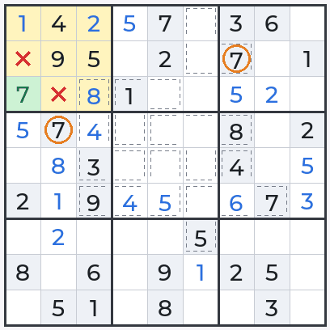

<!-- Written by tools/walkthrough.py sumless-killer: edit the script, not this page. -->
# Sumless Killer, step 18: the 7 in box 1

**Step 18 of 53** · [← Step 17](step-17.md) · [All steps](../sumless-killer.md#the-whole-puzzle-step-by-step) · [Step 19 →](step-19.md)

Box 1 needs a 7. r2c1: row 2 has one (r2c7). r3c2: column 2 has one (r4c2). Only **r3c1** is left: **r3c1 = 7**.

**Step 18 of 53** · [← Step 17](step-17.md) · [All steps](../sumless-killer.md#the-whole-puzzle-step-by-step) · [Step 19 →](step-19.md)
