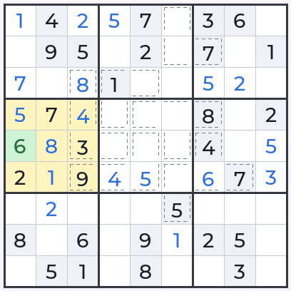

<!-- Written by tools/walkthrough.py sumless-killer: edit the script, not this page. -->
# Sumless Killer, step 19: the 6 in box 4

**Step 19 of 53** · [← Step 18](step-18.md) · [All steps](../sumless-killer.md#the-whole-puzzle-step-by-step) · [Step 20 →](step-20.md)

Box 4 needs a 6, and r5c1 is its last empty cell: **r5c1 = 6**.

**Step 19 of 53** · [← Step 18](step-18.md) · [All steps](../sumless-killer.md#the-whole-puzzle-step-by-step) · [Step 20 →](step-20.md)
