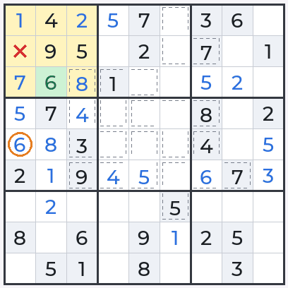

<!-- Written by tools/walkthrough.py sumless-killer: edit the script, not this page. -->
# Sumless Killer, step 20: the 6 in box 1

**Step 20 of 53** · [← Step 19](step-19.md) · [All steps](../sumless-killer.md#the-whole-puzzle-step-by-step) · [Step 21 →](step-21.md)

Box 1 needs a 6. r2c1: column 1 has one (r5c1). Only **r3c2** is left: **r3c2 = 6**.

**Step 20 of 53** · [← Step 19](step-19.md) · [All steps](../sumless-killer.md#the-whole-puzzle-step-by-step) · [Step 21 →](step-21.md)
