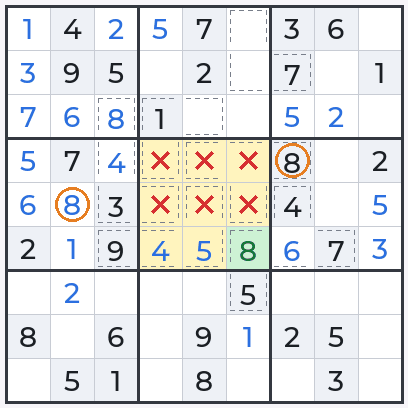

<!-- Written by tools/walkthrough.py sumless-killer: edit the script, not this page. -->
# Sumless Killer, step 22: the 8 in box 5

**Step 22 of 53** · [← Step 21](step-21.md) · [All steps](../sumless-killer.md#the-whole-puzzle-step-by-step) · [Step 23 →](step-23.md)

Box 5 needs an 8. r4c4, r4c5 and r4c6: row 4 has one (r4c7). r5c4, r5c5 and r5c6: row 5 has one (r5c2). Only **r6c6** is left: **r6c6 = 8**.

**Step 22 of 53** · [← Step 21](step-21.md) · [All steps](../sumless-killer.md#the-whole-puzzle-step-by-step) · [Step 23 →](step-23.md)
