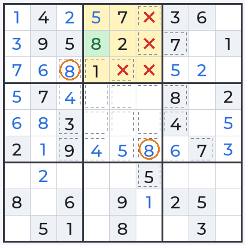

<!-- Written by tools/walkthrough.py sumless-killer: edit the script, not this page. -->
# Sumless Killer, step 23: the 8 in box 2

**Step 23 of 53** · [← Step 22](step-22.md) · [All steps](../sumless-killer.md#the-whole-puzzle-step-by-step) · [Step 24 →](step-24.md)

Box 2 needs an 8. r1c6 and r2c6: column 6 has one (r6c6). r3c5 and r3c6: row 3 has one (r3c3). Only **r2c4** is left: **r2c4 = 8**.

**Step 23 of 53** · [← Step 22](step-22.md) · [All steps](../sumless-killer.md#the-whole-puzzle-step-by-step) · [Step 24 →](step-24.md)
