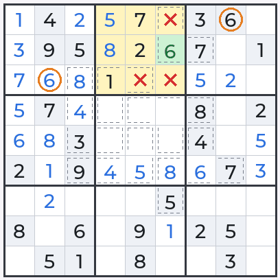

<!-- Written by tools/walkthrough.py sumless-killer: edit the script, not this page. -->
# Sumless Killer, step 24: the 6 in box 2

**Step 24 of 53** · [← Step 23](step-23.md) · [All steps](../sumless-killer.md#the-whole-puzzle-step-by-step) · [Step 25 →](step-25.md)

Box 2 needs a 6. r1c6: row 1 has one (r1c8). r3c5 and r3c6: row 3 has one (r3c2). Only **r2c6** is left: **r2c6 = 6**.

**Step 24 of 53** · [← Step 23](step-23.md) · [All steps](../sumless-killer.md#the-whole-puzzle-step-by-step) · [Step 25 →](step-25.md)
