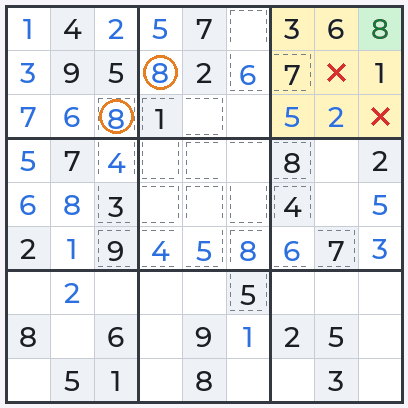

<!-- Written by tools/walkthrough.py sumless-killer: edit the script, not this page. -->
# Sumless Killer, step 25: the 8 in box 3

**Step 25 of 53** · [← Step 24](step-24.md) · [All steps](../sumless-killer.md#the-whole-puzzle-step-by-step) · [Step 26 →](step-26.md)

Box 3 needs an 8. r2c8: row 2 has one (r2c4). r3c9: row 3 has one (r3c3). Only **r1c9** is left: **r1c9 = 8**.

**Step 25 of 53** · [← Step 24](step-24.md) · [All steps](../sumless-killer.md#the-whole-puzzle-step-by-step) · [Step 26 →](step-26.md)
