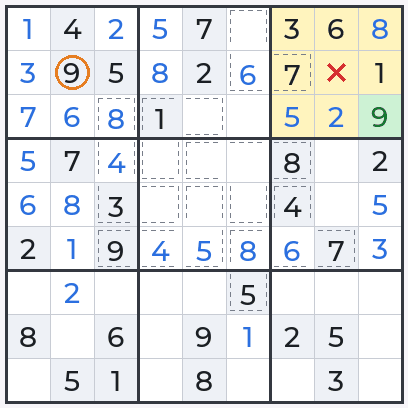

<!-- Written by tools/walkthrough.py sumless-killer: edit the script, not this page. -->
# Sumless Killer, step 26: the 9 in box 3

**Step 26 of 53** · [← Step 25](step-25.md) · [All steps](../sumless-killer.md#the-whole-puzzle-step-by-step) · [Step 27 →](step-27.md)

Box 3 needs a 9. r2c8: row 2 has one (r2c2). Only **r3c9** is left: **r3c9 = 9**.

**Step 26 of 53** · [← Step 25](step-25.md) · [All steps](../sumless-killer.md#the-whole-puzzle-step-by-step) · [Step 27 →](step-27.md)
