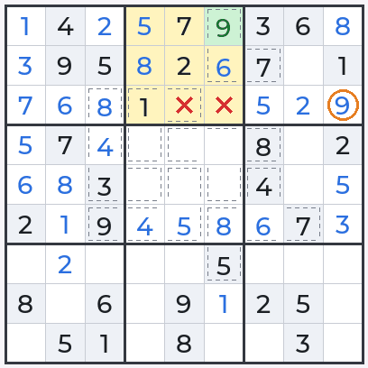

<!-- Written by tools/walkthrough.py sumless-killer: edit the script, not this page. -->
# Sumless Killer, step 27: the 9 in box 2

**Step 27 of 53** · [← Step 26](step-26.md) · [All steps](../sumless-killer.md#the-whole-puzzle-step-by-step) · [Step 28 →](step-28.md)

Box 2 needs a 9. r3c5 and r3c6: row 3 has one (r3c9). Only **r1c6** is left: **r1c6 = 9**.

**Step 27 of 53** · [← Step 26](step-26.md) · [All steps](../sumless-killer.md#the-whole-puzzle-step-by-step) · [Step 28 →](step-28.md)
