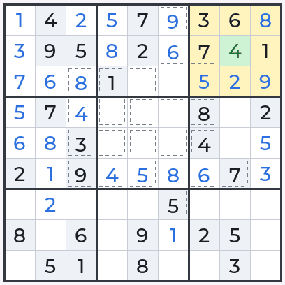

<!-- Written by tools/walkthrough.py sumless-killer: edit the script, not this page. -->
# Sumless Killer, step 28: the 4 in box 3

**Step 28 of 53** · [← Step 27](step-27.md) · [All steps](../sumless-killer.md#the-whole-puzzle-step-by-step) · [Step 29 →](step-29.md)

Box 3 needs a 4, and r2c8 is its last empty cell: **r2c8 = 4**.

**Step 28 of 53** · [← Step 27](step-27.md) · [All steps](../sumless-killer.md#the-whole-puzzle-step-by-step) · [Step 29 →](step-29.md)
