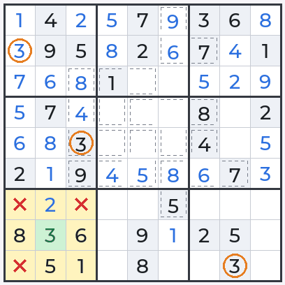

<!-- Written by tools/walkthrough.py sumless-killer: edit the script, not this page. -->
# Sumless Killer, step 29: the 3 in box 7

**Step 29 of 53** · [← Step 28](step-28.md) · [All steps](../sumless-killer.md#the-whole-puzzle-step-by-step) · [Step 30 →](step-30.md)

Box 7 needs a 3. r7c1: column 1 has one (r2c1). r7c3: column 3 has one (r5c3). r9c1: row 9 has one (r9c8). Only **r8c2** is left: **r8c2 = 3**.

**Step 29 of 53** · [← Step 28](step-28.md) · [All steps](../sumless-killer.md#the-whole-puzzle-step-by-step) · [Step 30 →](step-30.md)
