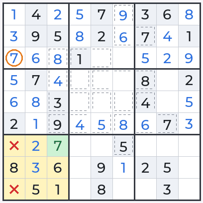

<!-- Written by tools/walkthrough.py sumless-killer: edit the script, not this page. -->
# Sumless Killer, step 30: the 7 in box 7

**Step 30 of 53** · [← Step 29](step-29.md) · [All steps](../sumless-killer.md#the-whole-puzzle-step-by-step) · [Step 31 →](step-31.md)

Box 7 needs a 7. r7c1 and r9c1: column 1 has one (r3c1). Only **r7c3** is left: **r7c3 = 7**.

**Step 30 of 53** · [← Step 29](step-29.md) · [All steps](../sumless-killer.md#the-whole-puzzle-step-by-step) · [Step 31 →](step-31.md)
